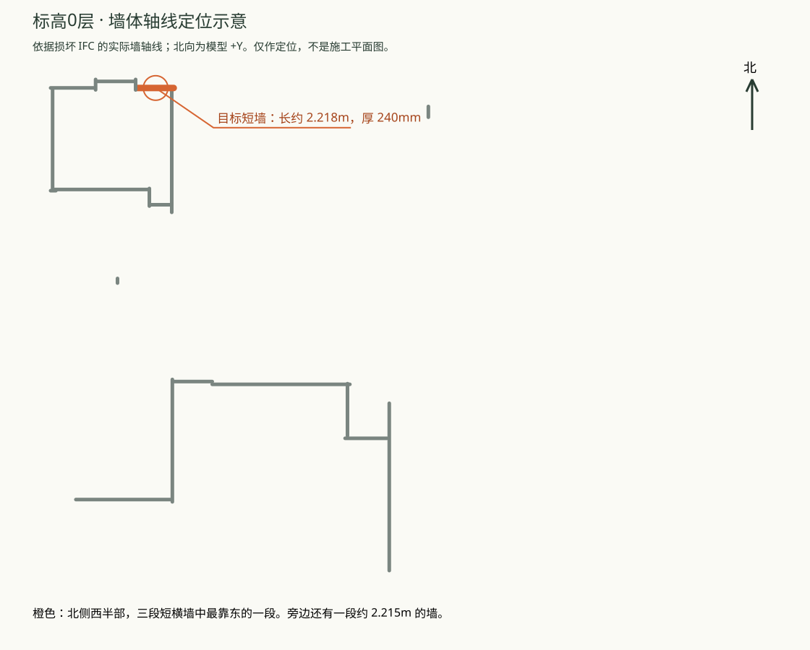

# Repair 人工检查

> **pending_human_review · 未登记**。仅供人工检查，不更新总索引、accepted 名单或阶段结论。

真实 DeepSeek 经公共 RepairAPI 完成实例属性修复，发布成功；独立重读核对通过。状态为 **pending_human_review**，尚未登记为 accepted Proof。

## 这案到底修了什么？

墙一直都在，形状也没有坏。我们人为断开了“这面墙”和“它的资料页”之间的一条连接。修复后，软件可以重新从这面墙直接读到原有信息。因此原始、损坏、修复三个模型的外观相同；这案应看属性前后对照，不能用“有没有补出一面墙”判断成功。

本案是一个偏底层的属性关联测试，原始请求确实比较技术化，不能当作“已证明理解普通工程师语言”的案例。

## 不用输入 GUID，怎样找到这面墙？

在楼层列表选择 **“标高0”**，查看**北侧西半部的折线外墙，三段短横墙中最靠东的一段**；墙长约 **2.218 米**、厚 **240 毫米**。下面的橙色段就是目标，点击原始／损坏／修复视图的定位链接也能直接选中它。

“标高0”是源模型中的楼层名称，其实际标高约 -2.344 米，不能直接替它改叫“一层”。GUID 只作为内部稳定编号留在真实请求和机器证据里，不要求人工抄写。

**当前能力边界：** 楼层＋约 2.22 米长度会同时命中两段墙，现有代码正确返回多候选。任意“北侧／从西数第二个／距转角若干米”的组合定位还需要补充空间位置合同与澄清流程；本页的人工定位说明不等于该生产能力已实现。

下一份自然语言请求可以采用这样的表达（**示意，尚未作为新的 Provider 输入执行**）：

> 请检查“标高0”层北侧西半部的折线外墙，最靠东那段约2.2米长、240毫米厚的墙。它的属性页里外墙标记和参考编号缺失了。请根据输入模型中仍能确认的信息恢复；如果目标或原值不唯一，先让我确认，不要改墙的形状或旁边的构件。

## 原始、破坏、修复三份 IFC

| 角色 | IFC | 可交互视图 |
|---|---|---|
| 原始 dataset 文件 | [01-original.ifc](01-original.ifc) | [原始视图](review-original.html) |
| 删除一条属性关联后，实际输入 | [02-damaged.ifc](02-damaged.ifc) | [破坏视图](review-damaged.html) |
| 真实 RepairAPI 发布的完整输出 | [03-repaired.ifc](03-repaired.ifc) | [修复视图](review-repaired.html) |

来源为 `dataset/external/bimnet/vvo.ifc`。original 的 `private_ground_truth` 角色在执行前冻结，仅供执行后评估；没有向 Provider 提供 pristine 原文件、删除关系的身份或 mutation 配方。

[保留的原始技术请求](request.html)指定上图目标墙的常用属性资料。只删除了一条 IfcRelDefinesByProperties；保留了原属性集和所有几何。公开请求值来自 damaged IFC 中尚存的独立属性集，见 [公开输入事实](evidence/frozen/public-input-facts.json)。

| 直接实例属性 | 原始 | damaged | repaired | IFC 类型 |
|---|---|---|---|---|
| 参考编号（Reference） | "240" | 墙的直接资料连接缺失 | "240" | IfcIdentifier |
| 标记为外墙（IsExternal） | 是 | 墙的直接资料连接缺失 | 是 | IfcBoolean |
| 延伸到结构标记（ExtendToStructure） | 否 | 墙的直接资料连接缺失 | 否 | IfcBoolean |
| 承重墙标记（LoadBearing） | 否 | 墙的直接资料连接缺失 | 否 | IfcBoolean |

注意：损坏的是**实例直接关联**；Type 中已有的继承属性仍可能显示部分值。请查看 DirectProperties，不能只看 EffectiveProperties。[定位原始目标](review-original.html#2CsmzAChHF6O6maGXlo6PS)／[定位损坏目标](review-damaged.html#2CsmzAChHF6O6maGXlo6PS)／[定位修复目标](review-repaired.html#2CsmzAChHF6O6maGXlo6PS)。

## 独立验证及视觉检查

- 三份 IFC 均可重读；每份 152 个可见构件均可网格化。三份的世界网格、有效样式完全相同。
- repaired 相对 damaged 没有修改或删除任何既有 STEP 实体，只新增 4 个属性值、1 个属性集和 1 条关联。Type、材料、样式、几何及其他对象保留。
- 原始 dataset 文件与 damaged 输入哈希未变。恢复的是同值、同类型的合法属性附件，未伪造恢复删除关系的原 GlobalId。
- 实际三维整体视图已检查，修复前后外观相同；本次不美化或升级 Repair 门窗。[整体图](evidence/views/overall-depth.png)。
- [独立核对明细](evidence/frozen/independent-review.json)；[真实公共结果](evidence/frozen/result-live-04.json)；[机器评估](evidence/frozen/runtime-live-04/runs/repair-vvo-property-relation-live-04/.terminal-bundles/6395e2e7aa4c4e3c86e42a9146133e42/evaluation/public-evaluation.json)。

公共评估的 L1 与 preservation 通过；其 conditional L2 属性项为 not_required，不能拿该标签证明请求值正确。本案请求值由独立重读另行逐项核对。该语义评估适用于冻结三元组，不宣称运行了整个 IFCCompare 基准或系统能力评测。

## Attempts 与保留边界

成功的 live-04 有 2 次真实调用（Intent、ChangeSet），模型 deepseek-v4-flash。此前 attempt-02 也有 2 次真实调用，但执行包装器缺少 Windows multiprocessing 主入口保护，校验子进程失败，未发布成功 IFC；其原始响应、诊断 IFC 和失败结果全部保留。offline-03 是明确标记的 fake Provider 回归，不能算真实调用。startup-01 的非法 run-id 在网络前失败，见 startup-01-correction.json。

人工确认三元组和属性后，仍须执行适用 curator／人读格式检查，才能登记为 accepted Proof；本页已按既有格式收纳到 Proof 目录，但尚未登记。

## 原始技术请求全文（真实输入，原样保留）

请修复这个 IFC2X3 文件中墙体 2CsmzAChHF6O6maGXlo6PS 的实例属性关联。该墙的几何、Type、材料、颜色和其他对象均须保留。请按下述明确要求写入实例 Pset_WallCommon：Reference 为字符串 "240"，IsExternal 为布尔 true，ExtendToStructure 为布尔 false，LoadBearing 为布尔 false。上述属性值也可在输入 IFC 尚存的独立 Pset_WallCommon 属性集中核对；不要修改共享 Type，不要增加其他属性，也不要更改任何几何。请输出修复后的完整 IFC。

[完整证据导航](evidence/README.md) · [案例文件绑定](FILES.json)
