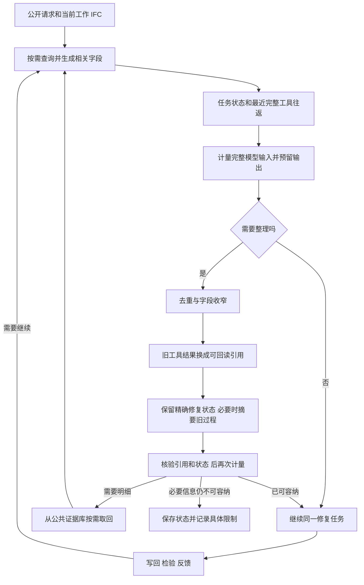

# Repair 短上下文：调研与开发建议

更新：2026-10-12。调研完成；按用户决定，先实现现有系统的 F/G 兼容层，研究扩展暂不开发。下面的研究比较与扩展建议不代表已实现的能力。

建议采用“按需读取 → 精简工具结果 → 保留结构化修复状态 → 按需取回证据 → 继续同一任务”。发送前计量仍然需要，但应先触发整理和恢复；只有无法容纳必要信息或任务预算耗尽时才终止。不能把上下文压缩等同于任务重开，也不能把压缩后的短输入直接当作修复能力提升。

本设计独立于已经冻结的 A～E 批次。当前运行状态与结果仍由[唯一实验入口](../../.tmp/repair-formal-1200-20261011/cycle/README.md)维护。后续 F/G 开发使用新的配置、版本和相关准入，不静默更换在途任务的 Harness。

## 0. 本轮实际实现

入口为 [qwen_batch.py](../../scripts/ifc_repair/qwen_batch.py)，上下文投影为 [qwen_context.py](../../scripts/ifc_repair/qwen_context.py)。独立新批次固定 F＝Qwen＋现有 Harness、G＝Qwen＋现有通用执行器，默认两项并发；复用原调度器、工作区隔离、账本、澄清、最终检验回环及结果导出。A～E 的源文件、冻结配置和在途任务不变。

默认总工作窗口 50,000，输出上限 8,192，协议余量 2,048。优先使用本地 Qwen3.5 官方 `tokenizer.json` 对序列化的请求计数；额外余量覆盖聊天模板差异。这是输入估计，实际用量仍以 API 返回为准。该数据文件下载到忽略的模型缓存，复用已有 `tokenizers` 库，没有安装新软件。新准入绑定 tokenizer 的内容哈希；无资产时可用带 25% 余量的词法估计，但它不保证与服务端完全一致。

接近窗口时，F 精简 JSON 和重复查询，只展示最近两批查询及当前提案／错误引用的证据。保留这些查询完整的对象列表、数量和完整性标志，原请求、单位、反馈及写入绑定不截断；原生核验器仍使用完整查询权威，旧资料可通过原查询接口重新获取。G 将旧工具结果存到当前公共工作区的 `.qwen-context`，用简要结果和可 `read_file` 的路径替代；必要时合并旧的完整调用／结果对，保留近期记录、全部用户答复及未完成调用。缓存随原工作区恢复和清理，不增加对外结果文件。

429、500／502／503／504 和网络超时最多尝试三次，默认退避 2、8 秒，尊重最多 30 秒的 `Retry-After`。普通 400、鉴权错误不重试。明确的上下文 400 最多再用较小窗口精简一次。每个真实尝试独立计入同题账本，未知用量保留，失败也保留；成功恢复的临时错误不会误停整个队列。临时接口故障耗尽重试后，打开持久化 60 秒熔断，停止新派发；需要操作者 `resume`，不会自动重开终态失败题。

F 原有 384 KiB 场景安全上限仍在。若保护必要请求／schema／当前证据后仍无法容纳，才记录上下文失败；这套兼容层不承诺任意大小的任务都可修复，也未实现研究部分提出的完整状态记忆与索引失效机制。

单题 S1／S2／S3 的累计 token、次数和时间预算保持原规则。每项仍最多 `report.md`＋`repaired.ifc`，操作者只接收调度摘要。F/G 使用新 `--root`，不能接管原七组正式账本或覆盖旧失败；`prepare` 后策略被冻结，真实运行仍需要相关 scoped＋native 准入。

## 1. 当前代码已经做了什么

以下结论来自本轮读取实现，未通过新模型实验推定收益。

| 路径 | 已有机制 | 当前缺口 |
|---|---|---|
| B/E/F 的公开场景定位 | `PublicScene` 按类别、楼层、宿主及空间条件查询；分页、摘要/几何详情分开；`prompt_context()` 合并同一实体和类型，去重查询 | 已披露实体与查询仍不断累积。定位阶段按 384 KiB 字节限制阻断，不是针对各模型窗口的可恢复整理 |
| B/E/F 的 ChangeSet 生成 | 语义 manifest、选定 operation/profile、紧凑 draft authority；生产检验错误以有限条目反馈 | 阶段投影已经节省输入，但不等于统一的短上下文管理；结构事实与旧定位明细还没有一致的移出、取回和失效机制 |
| A/C/G 的通用执行器 | 文件支持分段读取，脚本输出有限长，账本保存会话 | `messages()` 重放历史 assistant 与工具结果；单次读取有限长无法限制累计历史 |
| D 的固定官方 DSH | 运行时具备旧历史摘要、近期消息保留、溢出后压缩重试，另有可选工具结果剪枝 | 这是 DSH 自己的能力，不会因 F/G 接通同一类 HTTP API 就自动进入我们的 Harness 或通用执行器；源码具备机制不代表本批实际触发或已经获得收益 |

对应实现：[scene_context.py](../../src/text2ifc_ifc_repair/scene_context.py)、[scene_grounding.py](../../src/text2ifc_ifc_repair/scene_grounding.py)、[provider_stage.py](../../src/text2ifc_ifc_repair/provider_stage.py)、[isolated_direct.py](../../scripts/ifc_repair/repair_comparison/isolated_direct.py)。`context.py` 另有有界的 operation-aware 公共上下文构建器；它不能代替上述动态场景路径的管理。

用户提出的约 50K 在本设计中作为短窗口实验目标。此前接口探针记录的是 262,144 输入＋输出总窗口；两者不能混为同一测量。API 地址、后端和服务配置可能变化，新开发配置应重新记录有效窗口。调研阶段的单路小请求及两路请求都返回 503，后续兼容试跑也因 503 停止；具体状态见唯一实验入口。压缩不能解决服务不可用。用户现已要求暂停真实 Qwen 调用，恢复服务后也不自动启动。

## 2. 主要方法与适用性

检索覆盖原始论文、官方框架文档/源码及 IFC 近邻工作，重点阅读相关方法与限制。检索词包括 observation masking / agent compaction / context folding / external memory / recursive language models / IFC memory / schema-guided IFC。下表保留能影响本设计的来源，不使用社区二手解读作为技术依据。框架在线文档反映查阅时状态；本地 DSH 源码已核对为 `dsh-v0.2.0-rc.1`。

| 方法与原始来源 | 实际机制 | 对本项目的判断 |
|---|---|---|
| [SWE-agent 历史处理器](https://github.com/SWE-agent/SWE-agent/blob/main/sweagent/agent/history_processors.py)；[The Complexity Trap](https://arxiv.org/html/2508.21433v1) | 遮蔽较旧的大段环境输出，保留近期输出及操作历史。论文在 SWE-agent／SWE-bench Verified 中比较遮蔽与 LLM 摘要，简单遮蔽具有很强的成本与解题表现 | 第一版应包含这个简单基线。不能从代码任务推定 IFC 收益；只遮蔽观察仍不能无限控制越来越长的操作历史 |
| [OpenHands Context Condenser](https://docs.openhands.dev/sdk/guides/context-condenser)；[Anthropic Context Editing](https://platform.claude.com/docs/en/build-with-claude/context-editing) 与[上下文工程](https://www.anthropic.com/engineering/effective-context-engineering-for-ai-agents)；[OpenCode 配置](https://opencode.ai/docs/config/#compaction) | 老历史摘要、近期往返保留、工具结果清理、关键记忆外存等已经是成熟做法 | 可采用工程机制；通用自动摘要不是创新。厂商服务端特性不能直接传给任意 Chat Completions 网关 |
| [官方 DSH 压缩实现，固定版](https://github.com/deepseek-ai/deepseek-harness/blob/dsh-v0.2.0-rc.1/packages/compaction/compaction-basic/README.md) | 按窗口压力整理；可先剪枝再摘要；确认溢出后有界重试；维持工具调用/结果边界与持久检查点 | 是直接可借鉴的实现。其默认额外余量为 65,536 token，不能照搬到 50K 窗口；小窗口须明确覆盖阈值、余量、保留量和摘要输出 |
| [MemGPT](https://arxiv.org/html/2310.08560v2) | 当前上下文与外部 recall/archive 分层，模型通过工具移动、检索记忆，队列压力触发整理 | “原文在上下文外，按需取回”已有先例。我们可以复用现有账本与公共索引，不必安装新的记忆框架 |
| [AgentFold](https://arxiv.org/html/2510.24699v1)；[ReSum](https://arxiv.org/html/2509.13313v2) | AgentFold 对历史按多种粒度折叠；ReSum 周期性生成任务摘要并继续推理。论文还采用专门的训练来提升这些行为 | 启发操作/子任务粒度整理。不能假定给现有 Qwen 增加一段 prompt 就得到论文中训练后模型的表现 |
| [A-Mem](https://arxiv.org/html/2502.12110v1)；[ACE](https://arxiv.org/html/2510.04618v1) | 原子记忆、链接与演化；结构化增量更新，减少反复全量摘要造成的信息消失 | 可借鉴增量状态更新。本实验应先做单题内记忆，避免跨题学习与跨组共享轨迹污染比较 |
| [Recursive Language Models](https://arxiv.org/html/2512.24601v1) | 将长输入作为外部程序环境中的变量，由模型用代码查看、分解，必要时递归调用子模型 | 支持“数据规模大于单次上下文”的总体路线。第一版用已有 IFC 解析/查询即可，先不引入额外子模型调用及其费用、延迟和恢复复杂度 |
| [LLMLingua-2](https://arxiv.org/html/2403.12968v1) | 训练 token 分类器，决定原提示词中哪些词保留 | 可用于说明文本的后续对照。对坐标、单位、关系键和 JSON 结构，优先做字段投影与无损去重；本项目尚未验证其能保全这些不变量 |

这里的“压缩”减少每次模型可见的内容，不会提高 API 的物理窗口。缓存优惠或服务端 KV-cache 优化，也不能代替输入管理。摘要本身的调用与后续补查均需计入整题成本；少一次输入但多出许多往返，可能没有实际节省。

## 3. IFC 近邻与可以研究的差异

[MCP4IFC](https://arxiv.org/html/2511.05533v1) 已提供精简场景查询、IFC 创建/修改工具及动态工具生成。因此，“解析 IFC 后只返回精简构件”已经有先例。[IFCMemoryBench](https://arxiv.org/html/2607.26072v1) 则评估跨会话记忆与实时 IFC 查询结合，并直接指出精确项目事实、单位和实体关联的保留问题。该工作主要研究信息检索与记忆，不是本项目的短窗口局部损伤修复试验。

[IFC-Agent](https://www.sciencedirect.com/science/article/pii/S0926580526001299) 的出版方摘要还声明了 schema-guided 查询、修改和过程记忆／实体缓存。本轮未取得该文全文，不能断言它没有处理下述机制。正式贡献定位前需要补读其完整方法。

据此，值得验证的候选研究问题是：**在有限上下文中，能否同时降低修复轨迹的输入量，并保留目标定位、变更授权和修复核验所需的精确依据？** 重点是执行中的一致性，不能以“首次给 BIM 加 RAG／记忆／摘要”作为贡献。

建议围绕四个相互配合的机制开发：

1. **按本轮操作组织 IFC 相关事实。** 窗任务包含目标/参照窗、宿主墙、洞口/填充、楼层与坐标变换；属性任务包含实例/类型、属性路径、类型和值、有效单位。程序按语义关系和空间条件查找，随后取操作需要的字段。不能仅按 STEP 文件连续行或空间盒子切块，因为必要关系可能位于文件和空间的远处。
2. **精确事实与过程摘要分别保存。** 坐标、尺寸、单位、类型、属性路径、已披露身份、用户答复、允许操作与当前检验错误由程序保留。模型可摘要旧探索过程，但摘要不能产生新的事实、授权或“已验证”状态。
3. **定位核验依据可以移出上下文，但必须可重新检查。** 内部保存查询条件、候选覆盖范围、原始结果及其模型版本；上下文可以只引用这些依据并呈现当前相关候选。Top-K 或摘要不能冒充“目标唯一”；写回前仍由现有确定性核验器检查身份与完整性。
4. **修改后失效与按需取回。** 成功写回推进工作模型版本，让受影响对象及其关系的旧几何/属性事实失效；补查从当前公开工作副本重算。回滚、恢复也保持同一状态与预算。依赖索引可逐步细化，第一版宁可保守地清除受影响查询缓存，也不能使用旧尺寸继续修复。

以上是候选工程与研究设计；源码检查和文献不能证明其收益或独创性。真正差异需用与简单遮蔽、通用摘要的配对比较来证明。

## 4. 建议的第一版行为

计量对象包含 system、原请求、工具/schema、修复状态、摘要、历史和消息模板开销；不是 IFC 文件大小。优先使用与服务模型匹配的 tokenizer 和模板，再用实际返回的 prompt usage 校准，未知部分保留余量。账本中的字节预留不能冒充真实 token 计量。

以 50,000 总窗口为开发例子：输出预留 8,192、模板/估算余量 2,048，输入可用量最多 39,760。可在约 32K 输入前开始整理，并尝试回到约 22～26K。数值仅用于说明高低水位机制，尚未冻结；包含输出的完整预算、固定系统内容和实际响应需求必须共同决定阈值。不能一直把上下文推到硬边界，也不能等到原历史已无法送入摘要模型时才开始摘要。

优先无模型整理；仍需要摘要时，提前处理能够放入窗口的旧片段，使用同一被测底座并核验结构状态。无法整理的巨大单条工具结果应在工具侧分段/字段化、提供回读引用；摘要输出截断、引用丢失或状态校验失败时保留上一个有效状态，不提交缺失事实的版本。

F 的改动进入 B/E/F 共用 Harness 的新候选版本，以模型窗口配置决定强度。G 使用方法中性的历史整理与工具结果回读，不额外加入 IFC 定位指导；若未来与 A/C 比较，应使用同版通用执行器。当前冻结批次不改变方法。

记忆与引用复用现有单题账本和公开索引；不共享其他题/组的轨迹，不读取 Gold、损伤配方或删除前信息。导出继续只有 `report.md` 与可选 `repaired.ifc`；内部恢复依据不变成更多逐调用文件。实际 API 返回推理和必要失败证据仍保留，精简模型输入不等于删除它们。

接口 429/503/超时采用有界退避、累计记账与队列熔断；确认的上下文溢出则触发整理后有界重试，两者分开。重试不重新执行已经成功的工具操作，不另开任务、不重置 token/活动时间。真正缺少用户事实仍走澄清；公共 IFC 中可查的信息应先查，压缩不能用于猜测事实。

## 5. 开发顺序与验证

1. 先实现完整输入计量、旧工具结果替换/回读、近期完整工具往返保留与检查点恢复。无需安装新框架，也不依赖 Qwen 服务在线。
2. 在定位和 ChangeSet 阶段复用已有 authority/manifest，增加结构化单题状态和按操作选择事实；不改定位真值条件或写入授权合同。
3. 增加模型版本检查、写回后缓存失效、低水位整理及可选过程摘要。把这部分与网络重试分开测试。
4. 离线验证通过并形成新阶段准入后，Qwen 恢复时先做开发题小样本；脚本只输出压缩次数、输入峰值、终态、用量和异常摘要，Codex 不逐题阅读产物。

离线测试须覆盖：长工具输出与多次小输出累计；工具调用/结果配对；中文请求和工具定义的开销；毫米/米/英尺与世界/局部坐标；同名多目标及完整候选核验；混合题未完成操作；最新检验错误；用户澄清；摘要失败/截断；修改后旧缓存；中断恢复与累计预算；私有事实和跨组轨迹不可进入上下文。正例、负例、边界及不同源模型在修改前冻结，沿用现有[验证协议](../validation/agent-capability-evaluation.md)，不触发全仓 Preflight。

效果比较建议至少包含现状、简单旧观察遮蔽、通用摘要、上述结构化状态方案；相同模型、窗口、任务预算与独立检查器。必要时用 16K／32K／50K 作为后续切片。记录所有失败、总输入/输出（含摘要/补查/重试）、活动时间、修复/保全结果及压缩引入的事实错误；揭示过的开发题不作为盲测收益证据。正式指标仍待用户确定，本文件没有更改实验评分。

验收目标应是“同一任务在整理后仍能正确定位、继续生成 ChangeSet 并接受独立核验”，而不仅是“没有再返回超上下文错误”。
