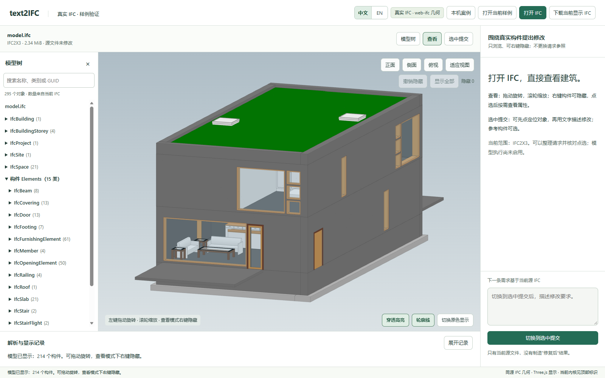

# text2IFC UI：GitHub 交接入口

网页、接口适配、依赖声明、启动脚本与开发文档均在 `codex/ui-development`。新目录仅从远程检出并创建环境，已验证本机网页启动、IFC 显示、上传与请求准备；不需要旧 UI 目录或整个本地备份。

## 从这里继续

- [开发与启动入口](../../../UI-START-HERE.md)
- [工作台使用说明](../../../ui/ifc-viewer/README.md)
- [独立远程重建记录](../ui-clean-rebuild-20261016.md)
- [唯一 UI 实施计划及已知限制](../../plans/repair-ui-plan.md)

在仓库根目录使用 Python 3.12 与 Node.js 24：

```powershell
python -m venv .venv
.\.venv\Scripts\python.exe -m pip install -e ".[web,web-test]" -c docs/reports/ui-delivery-20261016/clean-rebuild/constraints-win-py312.txt
$env:TEXT2IFC_UI_LIVE='0'
node ui/ifc-viewer/launcher.mjs start
```

打开 `http://127.0.0.1:4178/ifc-viewer/`，API 为 4180；点击“打开 IFC”选择自己的 IFC2X3。启动器也支持独立端口，见重建记录。源码包含浏览器 JS/WASM，不需要 npm 安装。环境版本约束来自已通过检查的 Windows/Python 3.12 环境；其他平台不直接视为同等验收。

默认模式无需密钥，只准备请求。重新启用真实模型需要本机配置、当前阶段准入与新额度；2026-10-11 的三任务额度已经用完。向量检索模型/数据库、Generation、自动返工及公网部署不在本次重建验收范围。

## 三项真实联调：原结果已公开保存

| 案例 | 实际效果与独立检查 | 调用 / 返回 tokens |
|---|---|---|
| [补门](cases/door-1/REPORT.md) | 新增一扇门，完整检查通过 | 4 / 60223 |
| [澄清后补窗](cases/window-2/REPORT.md) | 同一任务问答后新增一窗，完整检查通过 | 10 / 330133 |
| [双目标补窗](cases/multi-3/REPORT.md) | 两面目标墙各新增一窗；输入原有三条规范错误保留，整文件检查不通过 | 4 / 101311 |

每案有实际请求、输入/输出 IFC、原独立检查及前后截图。它们来自 2026-10-11 的真实调用，本次没有重新调用模型，也没有将双目标的离线修正冒充真实通过。

[原始记录包](live-records.zip)保存 287 个文件：三项浏览器记录、三个原生 run 的全部现存文件与对应预算账本；原始文件逐字节保留，ZIP 完整性及每个成员 SHA-256 已核对。[清单](manifest.json)绑定原目录相对路径、大小、哈希及人读副本来源。这是历史联调记录，不是新 accepted Proof 安装，也不是系统能力基准。旧文件里的本机地址、绝对路径和 `?task=` 链接属于当时运行上下文，不能当成新机器的活动任务。

数据来源、许可及派生修改见 [NOTICE](NOTICE.md)。没有发布 pristine、private Gold、私有 174 样例或制题映射。

## 独立重建的证据

[检查摘要](clean-rebuild/checks.json)、[Python 日志](clean-rebuild/clean-final-regression.log)、[Node 日志](clean-rebuild/clean-node-tests.log)和[版本约束](clean-rebuild/constraints-win-py312.txt)已随仓库保存。100 项 Node 与 91 项相关 Python 检查通过，无跳过；网页中的公共 IFC 显示 295 个对象、214 个有网格构件；上传与请求准备均为 201，源下载字节一致。真实执行被关闭并返回预期错误，没有新增 Provider 调用。



## 删除本机目录前需要知道

就继续开发和重建网页而言，可以删除旧 UI 工作目录及本地整树备份；建议保留一个干净检出用于日常开发。若删除全部检出，将来仍可从 GitHub 重新克隆安装。

GitHub 不保存 `.env` 密钥、私有样例、浏览器配置、缓存、整棵虚拟环境、聊天导出和活动任务 SQLite。删除这些本地文件后，它们不能从本次交付找回；真实历史结果仍可在上述静态记录中查看，但旧 `?task=` 活动会话不会自动恢复。密钥应由操作者重新配置，不应上传仓库。

本轮没有执行删除，也没有修改原 `E:\code for project\bimnet` 的 Repair 工作树、分支、进程、数据、账本或 Proof。清理 UI 时不要把原 Repair 目录作为目标。Git/LFS 的远程对象与本机缓存不是同一件事；按用途只取具体 LFS 文件，不需要为启动网页下载整套数据。
