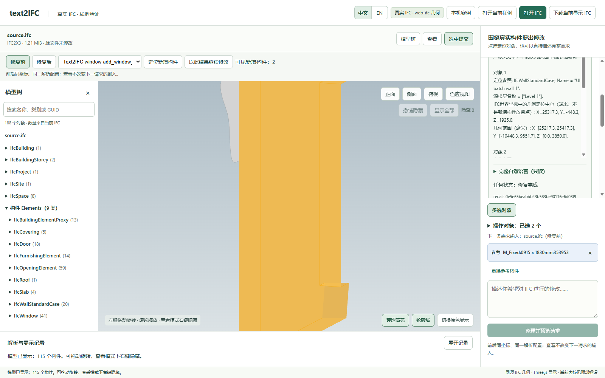
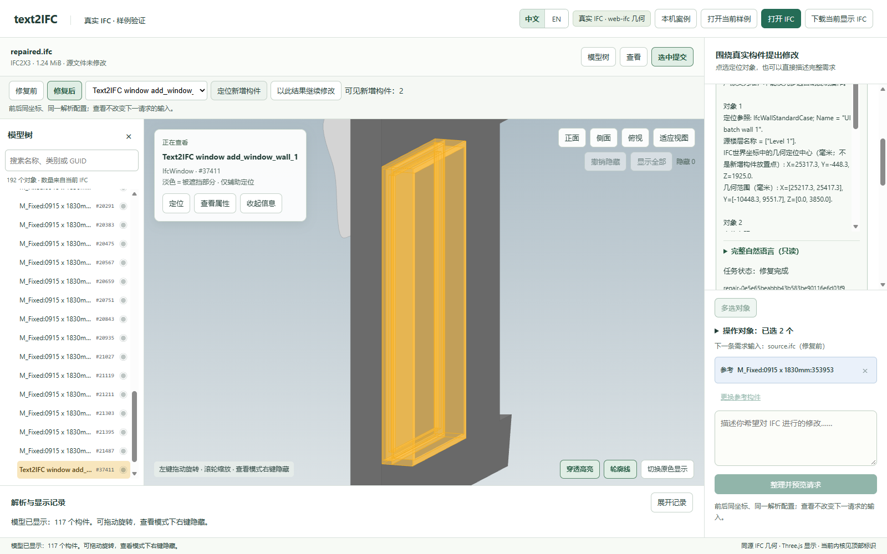

# 双目标各补一窗：新增两窗及目标绑定通过；整文件规范检查不通过

本记录来自 2026-10-11 的真实网页与 Provider 联调，不是本次重新执行，也不作为新增正式 accepted Proof。

- 实际任务：`task-3a961fe89e784f4388ae5fda1725272a`；原生运行：`repair-0e5e65beabbb43b583be90116e6d03f9`。
- 实际调用 4 次，返回 tokens 101311。
- 结果：新增两窗及目标绑定通过；整文件规范检查不通过。输入已有三条 IFC 规范问题，输出保留相同三条，没有新增。原失败保留，未用离线修正结果替换真实结果。
- [实际请求](request.txt)、[实际输入](damaged.ifc)、[实际输出](repaired.ifc)、[原独立检查](independent-checks.json)。没有附 pristine、private Gold 或 original 模型。
- 完整原生状态、全部 Provider 轮次、原始浏览器记录及预算账本见[原始记录包](../../live-records.zip)，成员路径与哈希见[清单](../../manifest.json)。解压后仅用于只读审阅，不把旧批准或预算复用为新的模型调用授权。

