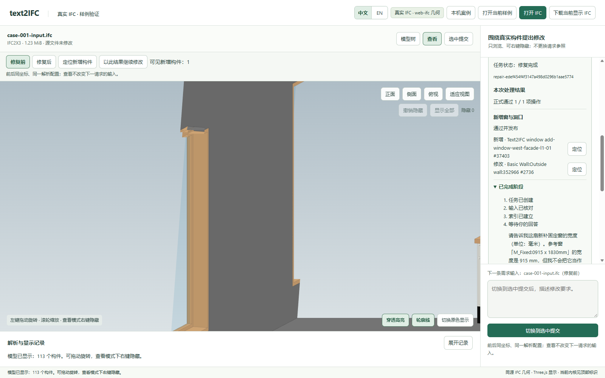
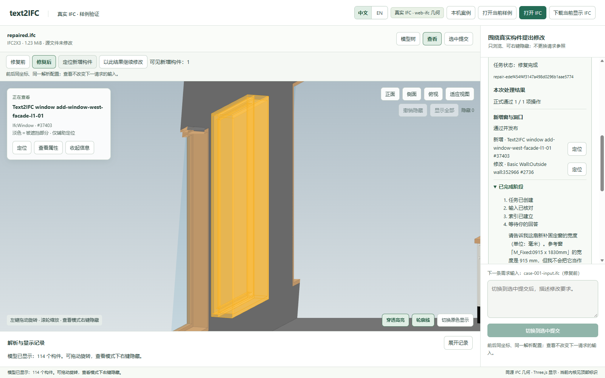

# 澄清后补窗：独立完整检查通过

本记录来自 2026-10-11 的真实网页与 Provider 联调，不是本次重新执行，也不作为新增正式 accepted Proof。

- 实际任务：`task-5a8badf4e4774a799d8800b9636c17ab`；原生运行：`repair-edef454f4f3147a498d0296b1aae5774`。
- 实际调用 10 次，返回 tokens 330133。
- 结果：独立完整检查通过。原输入与实际输出均可独立打开；当时完整 Schema/EXPRESS 检查为零诊断。
- [实际请求](request.txt)、[实际输入](damaged.ifc)、[实际输出](repaired.ifc)、[原独立检查](independent-checks.json)。没有附 pristine、private Gold 或 original 模型。
- 完整原生状态、全部 Provider 轮次、原始浏览器记录及预算账本见[原始记录包](../../live-records.zip)，成员路径与哈希见[清单](../../manifest.json)。解压后仅用于只读审阅，不把旧批准或预算复用为新的模型调用授权。

