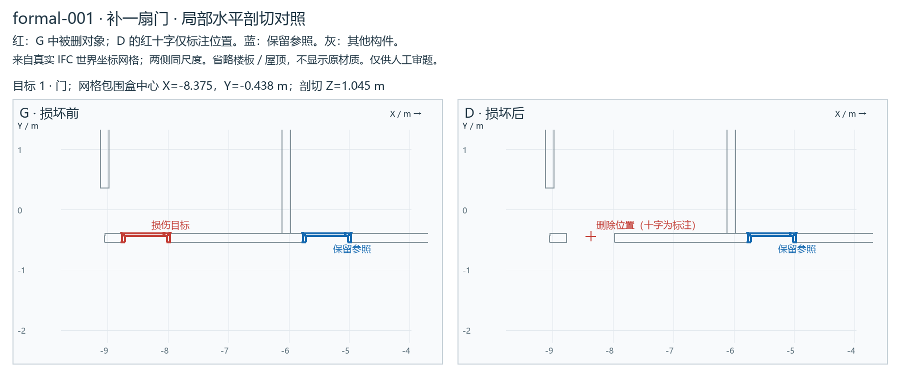
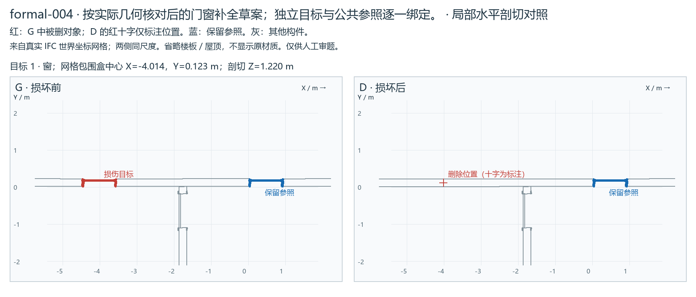
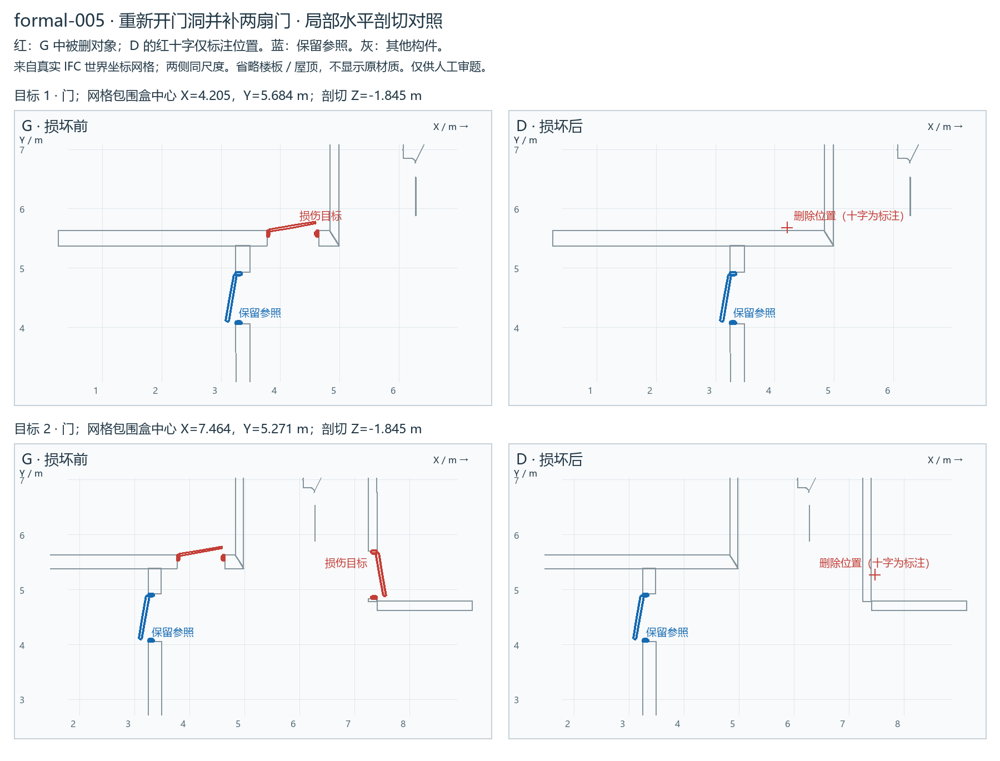
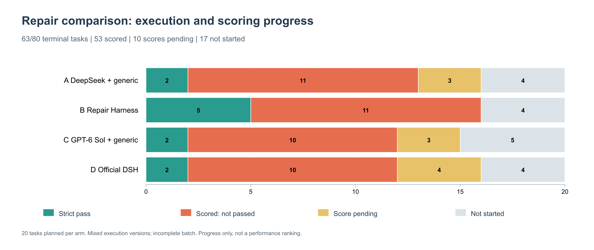

# text2IFC 周报：IFC Repair 数据准备与四组对比实验

**汇报周期：2026 年 10 月 5 日—10 月 8 日；实验数据截至 10 月 8 日 16:35（北京时间）。**

本周围绕“已有 IFC 模型＋自然语言要求”的局部修复开展实验准备与验证。已经完成原计划前半部分的数据扩展、损伤制题、技术审核与运行流程建设：在首批 5 题基础上补充 15 题，形成 **20 个不同 IFC 源文件、20 套修复任务、38 个待修复门窗目标**。四组实验已取得 **63/80 个任务终态**，但全量评测尚未结束；当前重点是解决 B 组 Repair Harness 暴露的共性问题，并对原首批五题进行独立开发复验。

本周成果可以归纳为三项：**形成可复用的实验题库；跑通四种方法的实际运行与记录流程；通过失败分析定位并修复一批 Harness 的确定性缺陷。** 当前结果仍属阶段快照，尚不能给出最终方法排名。

## 1. 实验目标与四组设计

实验希望区分模型和执行系统对 IFC 修复结果的影响：在相同损坏模型、相同用户要求和同题预算下，比较通用执行器、项目 Repair Harness 与官方 DeepSeek Harness（DSH）的表现。

|组别|请求模型与 API 协议|模型负责什么|Harness 负责什么|
|---|---|---|---|
|A|`deepseek-v4-flash`；Chat Completions|自主读取 IFC、选择工具、编写脚本或直接编辑、提问与提交|中性通用工具循环，提供文件读写、文本替换、命令执行、问答和提交；不替模型选择修复方法|
|B|`deepseek-v4-flash`；Chat Completions|理解请求，结合公共场景查询定位，必要时解析属性，输出结构化 ChangeSet|项目 Repair Harness：从公开 IFC 建立精简场景与查询结果，确定性绑定参数、约束修改，在副本上原子应用并核验发布|
|C|`gpt-6-sol`；Chat Completions|与 A 相同的自主修复任务|与 A 相同的通用执行器；通过 GPT API 运行，不使用日常 Codex 的完整执行环境或个人技能|
|D|`deepseek-v4-flash`；Messages|在官方原生工具与会话中自主修复、提问和提交|官方 DSH 的完整 `sdk` profile，保留文件／Shell 工具、子 Agent 和上下文压缩；SDK 与 runtime 均固定为 `0.2.0rc1`|

DeepSeek 用于 A、B、D 的模型调用，只有 D 使用官方 DSH；B 使用的是项目自己的领域 Harness。A–B 比较同一请求模型别名下的通用与领域执行方式，A–C 比较相同通用执行器下的模型差异，B–D 比较两套完整系统。检索、几何应用和独立评分中的确定性程序不算额外修复模型。

同一题四组获得相同的损坏 IFC 和自然语言请求，并使用独立工作副本和会话。A/C 不附加修复方法教程；B/D 保留原生方法。A/B 显式启用 `thinking`，C/D 设置 `reasoning_effort=high`；不同协议的推理参数不能直接视为完全等价。同名服务别名也不等于不可变权重快照，因此保存请求型号、实际返回标识、协议和执行版本。

计划规模为 **20 题 × 4 组＝80 个任务单元**。原始参考模型、损伤记录、验收条件与答复卡留在制题／评估侧，修复模型不能读取这些私有材料。评分依据修复产物和冻结条件，失败、无输出与预算停止均保留。

### 1.1 已确定的评审指标

**指标定义已确定，核心独立评分已实现。** 主指标是严格任务成功率，数量、构件、关系、格式、保全、澄清和资源用于解释成功与失败，不加权混成一个总分。

|指标|计算或判定方式|
|---|---|
|严格任务成功率|正式提交、全部目标构件、必需关系、IFC 格式及范围外保全全部通过才算成功；完整实验每组报告成功题数／20|
|数量完成率|实际新增门／窗按各类要求数量分别封顶，再除以应补总数；数量齐全不代表修复正确|
|构件修复完成率|类别、名义尺寸、实际几何、位置、公开参照／外观及必要关系全部满足的目标数／应修目标数|
|关系修复完成率|正确恢复的必需语义连接数／事前登记的应修关系数；按连接计数，不按 IFC 关系记录条数计数|
|IFC 校验通过率|正式结果可重开、schema 正确，并通过固定版 IfcOpenShell 的 schema＋EXPRESS 检查；不只看能否打开|
|范围外保全与附带错误|记录非授权修改、删除、重建、多余对象／关系及受影响对象数；无产物时保全不可评估|
|澄清与交互成功|3 道澄清题分别检查必要事实是否被问到并获得答复；交互成功＝澄清成功且最终修复成功；所有题另记实际问答次数|
|资源与执行代价|整题累计输入／输出 token、模型调用次数、工具往返、活动时间、人工等待和总历时；失败、重试、压缩及子 Agent 的可获取用量均计入|

数值核验使用冻结的 **1 mm 长度／位置容差**；0.5 m 仅用于对象粗匹配，不能作为修复位置误差容限。外观采用固定的公共参照几何与部件样式见证，不能证明等价的差异保留待审；配置中的角度字段当前未独立测量，不能写成角度精度已经验证。

终止且无输出的任务，适用数量／构件／关系记零，整题失败；等待用户、未运行和评分器故障分别保留 pending 或不可评估。最终数量／构件／关系首先按题做宏平均，再补充合并目标分母的微平均；**当前自动汇总已提供微平均，报告层的宏平均与不确定性分析仍需补齐**。实际费用也须有账单或价格依据，不能把 token 数直接当作金额。

指标口径固定不代表评分器已经没有缺陷。005 离线重放的共享几何保全误报尚未闭合，需修正评估程序后用保留产物同版重算；原真实失败不改写。指标定义见[评分规范](../../validation/repair-comparison/metrics.md)，实际实现见[独立正式评分器](../../../scripts/ifc_repair/repair_comparison/formal_scoring.py)。

### 1.2 单题预算与循环限制

下表是已冻结二十题的实际额度，**每个“题目 × 组别”分别适用，同题四组相同**。累计 token 指模型 API 返回用量规范化后的输入＋输出，不是单次上下文窗口。

|规模|题数|单任务累计 token 上限|模型调用上限|活动执行时间上限|单次实验命令工具时限|
|---|---:|---:|---:|---:|---:|
|S1：1 个目标|7|1,250,000|48 次|1,800 秒（30 分钟）|120 秒|
|S2：2 个目标|8|1,750,000|64 次|2,400 秒（40 分钟）|120 秒|
|S3：3 个目标|5|2,500,000|80 次|3,000 秒（50 分钟）|120 秒|

**整题调用次数、阶段循环和工具次数是不同的限制。** 一次模型响应可以包含多个工具操作，不能把 48 次调用写成 48 次工具使用。A/C 通过共同工具循环执行；D 保留原生循环，其子 Agent、重试和压缩请求归入同题账本。D 原生工具的内部时限保留自身语义，整题活动时间由实验控制器约束。

B 的场景定位一次执行最多 **8 轮模型响应**，查询与核验反馈共同占用额度；这不是整题最多 8 次调用。ChangeSet 生成及需要模型参与的属性解析，各自最多 2 次尝试。B 当前没有在最终应用／核验失败后自主反复重修的通用循环，失败会形成终态，而不是无限返工。

四组单次请求的最大输出均为 **65,536 token**，B 另有 65,536 的估算输入保护阈值；这两个值不能当成单任务累计预算或所有模型相同的实际上下文容量。网关调用前按“请求字节数＋最大输出”保守预留额度，故尚未耗完已知 token 也可能因下一次预留不足而停止；**预留量不是实际 token 成本**。用量缺失保留 unknown，不记为零，reasoning 已含于输出用量时不重复相加。

当前冻结额度的扩额数组为空，本批没有自动加预算规则。澄清后继续原任务，累计 token、调用和活动时间不清零；确认模型与工具均已停下后才计纯人工等待，准备与独立评分耗时另列。原生工具可以采用自身时限，但不能绕过整题上限。

用户批准的 **20M token 是总用量目标，超出无需再次审批，并非硬停止线**。80 项单任务上限合计为 141M，表示额度上限之和而非预计消耗；本页 16:35 快照的原批次已知实际用量为 42,751,820 token，另有 2 次未知用量。两 demo 原联调采用每任务 2.5M／100 次／90 分钟的开发额度，与本表正式额度分开；后续 B 开发复验与离线重放也分别记账。

预算与汇总代码见[正式编排](../../../scripts/ifc_repair/repair_comparison/formal_workflow.py)、[场景定位](../../../src/text2ifc_ifc_repair/scene_grounding.py)与[网关预算控制](../../../scripts/ifc_repair/repair_comparison/wire_gateway.py)。本节补充说明当前冻结设计，第 4 节与图片仍保持原 16:35 结果快照。

### 1.3 运行顺序与结果解释

每题按“冻结公开输入及私有评分条件 → 建立四个独立会话／工作副本 → 修复与必要澄清 → 冻结唯一正式产物或无输出终态 → 独立评分”执行。初版同一时刻只有一个活动任务，按题轮换 A→B→C→D、B→C→D→A、C→D→A→B、D→A→B→C；不中途读取私有评分来帮助模型继续，也不重开会话挑最好答案。

最终表分别列出四组逐题成绩与用量，再按 S1／S2／S3、门／窗／混合任务、信息充分／澄清任务分层。主对比为 B–A、C–A、B–D 的逐题配对。运行中出现的确定性修复保留前后执行版本；原批次、已经见过题目的开发复验和零模型调用的离线重放分别报告，不把它们合成未见测试成功率。样本存在共享来源族，20 题各一次运行也不能估计重复运行可靠性。

## 2. 完成数据采集、损伤制题与技术审核

### 2.1 从首批五题扩展到二十题

本周完成了额外 15 个 IFC 文件的选取和题包制作。这里的数量口径是 **20 个不同的 IFC 源文件**，这些文件来自多个开放数据来源，并非 20 个相互独立的数据集。

|准备项目|完成情况|
|---|---|
|源模型与许可|20 个不同 IFC；CC BY 4.0 共 9 份、MIT 共 9 份、GPL 3.0 或后续版本共 2 份|
|修复目标|38 个门窗目标，其中门 17 个、窗 21 个|
|损伤规模|S1：单目标 7 题；S2：双目标 8 题；S3：三目标 5 题|
|必要澄清|3 题预留无法从公开输入直接确定的洞底高度；其余 17 题公开信息充分|
|公开题包|每题提供损坏 IFC 和自然语言修复请求|
|评估材料|每题保留损伤前参考、损伤记录、验收条件、答复卡、数值核验及可视化材料|
|格式检查|20 份损坏 IFC 均已有本地 IfcOpenShell schema＋EXPRESS 通过记录|

损伤分为三类：删除门但保留原洞口；删除门及洞口并恢复连续墙面；删除窗及洞口并恢复墙面。后两类要求系统重新开洞并安装构件，比“只往现有洞口补构件”包含更多几何与关系恢复步骤。S1/S2/S3 表示目标数量，不直接等同于任务难度。

### 2.2 请求编写与审核原则

公开请求尽量使用楼层标高、方位、几何坐标和相对距离定位，**不提供被删除构件的 GUID 或 Name，也不提示具体实现方法**。必要尺寸、参照对象和保全要求写清楚，避免仅使用“和旁边一样”之类无法确定验收含义的表述。真实 Name 只出现在审题材料中，便于人工查找。

审核重点包括：定位是否唯一、毫米／米单位是否一致、名义门窗尺寸与墙洞尺寸是否分别正确、保留参照是否可见且可用、损伤是否只涉及指定对象、修复要求是否可解，以及损坏 IFC 是否仍满足格式规则。已有世界坐标网格对照和可旋转查看器辅助检查损伤。

**本批二十题的接受记录为委托技术审核，未将其写成用户逐题完成 usBIM 人工验收。** 本地格式与网格检查也不等同于任意外部查看器的显示兼容性。此前 formal-004 的原来源因显示问题被替换为 MIT 许可的 TallBuilding，保留了原拒收记录。

### 2.3 代表性题目与实际损伤图片

下列图片来自实际 IFC 的世界坐标网格，是**损伤前 G 与损伤后 D 的制题对照**。红色表示删除对象或删除位置，蓝色表示保留参照；它们不表示模型已完成修复。图片采用水平剖切，省略楼板／屋顶和原材质，完整几何可在各题查看器中检查。

**例一：formal-001，保留洞口补一扇门。**

删除内墙上的一扇门，保留原洞口。请求按楼层标高和约（−8.375，−0.461）米的位置定位，要求补宽 800 毫米、高 2075 毫米的门；以同墙沿 X 正方向 3 米处的保留门作为门框、厚度、材质和外观参照，保持洞口尺寸及其他构件不变。



**例二：formal-004，恢复墙洞并补一扇窗。**

删除一扇固定窗及其洞口，使损坏模型对应位置成为连续墙面。修复要求恢复 915 × 1830 毫米的窗与洞口，洞底距该层标高 305 毫米，并保持公开参照窗的框、扇和玻璃分格。原 B 组尝试已获得正式提交并通过冻结评分。



**例三：formal-005，重新开洞并补两扇门。**

地下层两处门及洞口一并删除，墙面恢复连续。请求要求在两处指定位置分别开出 870 × 2010 毫米的洞口并补门，以同层保留门为参照，按各目标墙面安装并适配墙厚。这一题同时涉及批量修复、不同墙厚和完整门实体复用。



图片标注采用构件网格包围盒中心；公开请求的定位依据可为门洞中心，两者并不必然重合。图中数值不代替各题独立的洞口和名义尺寸核验。三图对应的来源与许可记录见文末证据索引。

## 3. 完成运行环境接入与评测流程建设

四组已接入各自实际执行环境。A/C 使用同一套通用工具；B 通过原生 Repair API／CLI 与 SDK 运行；D 使用固定版本的官方完整 DSH。实验侧统一负责工作区隔离、模型调用账本、问答暂停／恢复、预算停止、正式产物收集和独立评分。

B 当前主要链路为：

```text
自然语言要求＋公开 IFC 的精简场景与按需查询
  → 核验目标、公开参照及位置
  → 确定性参数与语义授权
  → 模型生成 ChangeSet
  → 在副本上原子应用
  → IFC 重开、几何／关系／语义及范围外保全检查
  → 发布正式结果，或保留拒绝／失败状态
```

发生澄清时保留同一任务和累计预算；回答只提供实际被问到的已认可事实。运行记录保留请求、响应、工具操作、问答和可获取用量；API 实际返回的推理字段随证据保存，未返回的内容不补写。评分器与各组内部判断分别记录，避免“系统说完成了”直接等同于“修复通过”。

离线准入使用确定性假模型验证实际工具与运行链路，真实模型任务用于观察实际运行表现。两类证据分别记录，离线测试结果不计入四组模型成绩。

## 4. 部分真实实验结果

### 4.1 执行与评分进度

截至快照，原四组批次已有 **63 项终态，17 项尚未开始**。63 项中，26 项有正式 IFC 提交；已有独立评分的 53 项中，11 项严格通过，另 10 项终态的独立评分仍待完成。原批次累计已知用量为 **42,751,820 token**，另 2 次调用用量未知。



图中每组总长度均为 20 题；颜色依次表示严格通过、已评分未通过、终态待评分和未开始。图用于展示工作进度，不能作为最终方法排名。

|组别|已有终态／计划|正式 IFC 提交|严格通过／已评分|终态待评分|尚未开始|
|---|---:|---:|---:|---:|---:|
|A：DeepSeek＋通用执行器|16／20|2|2／13|3|4|
|B：DeepSeek＋Repair Harness|16／20|8|5／16|0|4|
|C：GPT-6 Sol＋通用执行器|15／20|13|2／12|3|5|
|D：DeepSeek＋官方 DSH|16／20|3|2／12|4|4|
|合计|63／80|26|11／53|10|17|

“终态”包括提交、无输出、预算停止和运行错误；“正式提交”仅说明存在可评分产物；“严格通过”还要求满足冻结的尺寸、位置、关系、格式、参照／外观及保全条件。待评分和未运行均不提前计作通过或失败。

### 4.2 首批五题的原始四组结果

|题目及任务|A|B|C|D|
|---|---|---|---|---|
|formal-001：保留洞口补门|通过|提交未达标|无正式提交|运行错误，后诊断为预算拒绝|
|formal-002：补两扇窗|预算停止|无正式提交|提交未达标|预算停止|
|formal-003：补一扇门、一扇窗|预算停止|无正式提交|通过|预算停止|
|formal-004：重新开洞补窗|预算停止|通过|提交未达标|预算停止|
|formal-005：重新开洞补两扇门|预算停止|无正式提交|提交未达标|预算停止|

当前可以观察到：部分方法能够完成可评分产物，但提交率和严格修复成功率存在明显区别；预算停止和确定性执行缺陷也影响端到端结果。因此，本周没有把所有失败简单归因为模型能力或请求表述不足。

原批次在共性问题修复期间包含不同执行版本，且全量任务与评分尚未结束。这些数字用于描述阶段表现，暂不据此宣称 B 优于其他方法或某次修复提升了整体成功率。

## 5. B Harness 的共性问题、修复与验证

多项失败已在场景阶段找到正确墙体和公开参照，但在参数确定、几何应用或核验阶段被拒绝。共性问题主要涉及下列机制。

|问题环节|发现的问题|修复方向|
|---|---|---|
|尺寸与单位|名义门窗尺寸被强等于墙洞几何尺寸；部分长度语义写回类型不正确；已有米／毫米错误|分别保留名义与洞口尺寸，按 IFC 长度属性写回，保持原容差|
|参照安装|只复用类型时丢失精确参照实例的安装位置；以整个门包围盒而非门框确定进深|把已核验的公开实例安装信息传到执行与独立核验，避免五金外伸改变门框位置|
|合法外伸几何|窗台板、门框及合法映射原点偏移被“整包围盒必须在洞内”等规则误拒|用精确公开参照及独立几何见证核验；无合法见证时仍拒绝|
|语义权威顺序|宿主或精确参照已有明确属性，同类型其他实例的冲突仍阻断执行|先处理更强的合法公共权威，保留无明确权威时的冲突拒绝|
|通孔与墙厚|默认把墙轴当作墙厚中心；源模型轴在墙面时，生成洞口只能切除半面墙|测量实际墙体相对墙轴的法向中心，使生成洞口完整穿墙|
|完整门实体及格式|无类型映射的完整门被简化成矩形体；复用后出现 IFC 表示归属约束冲突|复用核验过的完整公开 Body 与部件样式，建立合法表示容器，保留原参照和类型|
|多余开向澄清|精确复用的门类型为 NOTDEFINED，仍被当作新生成门强制询问左右开启|保留精确类型的“未定义”事实；不推断开向，显式冲突仍澄清|

这些修改针对通用不变量，不按题号补答案，也不通过放宽评分或向模型提供被删除构件身份来获得通过。源 IFC、公开题目和原失败记录保留；个别模型输出错误、缺失事实或支持范围外的案例继续保留为失败。

### 5.1 验证证据

- 完整公共安装／尺寸／语义等相关回归已有 **285 项通过**。
- 后续未定义开向权威分支的 **87 项相关回归通过**；与前套测试覆盖有交集，不将数量简单相加。
- 最新真实 Linux 公共链路测试收据为 **7 项通过**，其中容器测试覆盖 **7 个任务场景**：正常窗、问答恢复、错误尺寸拒绝、宿主属性权威、映射门基底、完整墙开洞补完整门、未授权墙厚适配拒绝。
- 容器任务得到预期的五个提交和两个拒绝；提交结果经重开和 schema＋EXPRESS 检查，源不变、原任务预算恢复和进程停止得到验证。此处模型传输为假响应，不属于真实模型成绩。

### 5.2 首批五题开发复验

在共性修复后，另设工作区对原 formal-001～005 的 B 组进行真实开发复验。**截至本周报快照，formal-001 已正式提交并通过原冻结严格评分**；同一原生会话累计 6 次模型调用、87,484 token。此前该题虽已定位正确，却因安装偏差未通过；本次又暴露多余开向澄清，修正一般分支后继续原会话完成。

其余四题在快照时尚未完成复验，因此目前只能报告这一单题的端到端验证，不能写成“五题均已通过”。复验属于已经揭示案例的开发验证，原正式批次的失败和成绩不覆盖，也不作为新的未见测试成绩。

## 6. 计划完成情况与下一步

|原计划内容|当前状态|
|---|---|
|两套开发样例与任务包形式|已完成，用于开发和流程联调|
|离线实验基础与统一运行记录|已实现，问答、预算、提交与评分链路已有离线证据|
|四组环境及 DSH 接入|已接通实际环境，并完成假模型运行验证|
|正式二十题采集、损伤、请求与技术审核|已完成；20 个不同源 IFC，共 38 个门窗目标|
|输入、评分规则及同题预算冻结|已有冻结记录；运行修订版本另行记录|
|全量八十项四组实验|未完成；原批次 63 项终态，17 项尚未开始|
|B 共性修复与首五题开发复验|离线修复与相关测试通过，001 真实复验通过，其余待完成|
|最终指标汇总与研究结论|未完成；仍需完成剩余评分与全量分析|

下一阶段先完成 B 原首批五题的端到端复验，分别核对构件、洞口、宿主关系、范围外保全及格式；对继续出现的共性缺陷回到离线定位和相关测试，特殊失败保留。随后安排剩余任务，完成所有终态的独立评分，汇总逐题四组结果、调用用量、澄清表现、预算停止与失败原因。

最终报告将区分模型输出错误、执行系统缺陷、预算或环境停止、以及评分／请求含义的局限，并明确各任务运行版本。当前 20 个不同文件仍存在共享来源族，后续方法优劣与泛化结论需要结合这种依赖关系和完整样本范围判断。

## 附录 A：二十题样本清单

全部条目均已完成委托技术审核。完整来源谱系、许可与逐题请求见[二十题入口](../../../dataset/processed/ifc-repair/repair-comparison/formal/README.md)。

|题号|源文件|许可|损伤规模及修复目标|
|---|---|---|---|
|001|model2.ifc|CC BY 4.0|S1：1 门|
|002|Type 4.ifc|CC BY 4.0|S2：2 窗|
|003|model_18.ifc|CC BY 4.0|S2：1 门＋1 窗|
|004|TallBuilding.ifc|MIT|S1：1 窗|
|005|AC90R1-niedriha-V2-2x3.ifc|GPL 3.0+|S2：2 门|
|006|INV-034.ifc|MIT|S1：1 窗|
|007|arc.ifc|GPL 3.0+|S1：1 窗|
|008|model_0_arc.ifc|CC BY 4.0|S2：2 门|
|009|model_7_arc.ifc|CC BY 4.0|S3：3 门|
|010|BIM4EEB_DEMONSTRATION_BLDG_FIN.ifc|CC BY 4.0|S3：3 窗|
|011|BIM4EEB_DEMONSTRATION_BLDG_POL.ifc|CC BY 4.0|S2：2 窗|
|012|model1.ifc|CC BY 4.0|S3：3 窗|
|013|model3.ifc|CC BY 4.0|S1：1 窗，须澄清洞底高度|
|014|INV-001.ifc|MIT|S1：1 门|
|015|INV-002.ifc|MIT|S2：2 门|
|016|INV-010.ifc|MIT|S2：2 窗，须澄清第一扇窗洞底高度|
|017|INV-015.ifc|MIT|S3：1 门＋2 窗|
|018|INV-020.ifc|MIT|S2：2 门|
|019|INV-030.ifc|MIT|S1：1 门|
|020|INV-044.ifc|MIT|S3：1 门＋2 窗，须澄清第一扇窗洞底高度|

## 附录 B：证据与图片来源

- [本周报的只读数据快照](2026-10-08/evidence.json)：原批次状态、已保存评分、用量及独立开发复验分开登记；不包含路由凭据或密钥。
- [可编辑制图脚本](2026-10-08/prepare_report.py)、[进度图 SVG](2026-10-08/figures/progress.svg)、[进度图 PDF](2026-10-08/figures/progress.pdf)、[图片来源清单](2026-10-08/image-sources.json)。三张损伤图按原字节复制，没有改绘几何。
- [B 共性问题与修复报告](../../validation/repair-comparison/b-common-repair.md)、[实验计划](../../validation/repair-comparison/plan.md)、[评分设计](../../validation/repair-comparison/metrics.md)。
- [formal-001 审题及图片来源](../../../dataset/processed/ifc-repair/repair-comparison/formal/formal-001/REVIEW.md)：[许可与修改记录](../../../dataset/processed/ifc-repair/repair-comparison/formal/formal-001/private/SOURCE-LICENSE.md)，Tafraout 来源、CC BY 4.0；IFC 经过本实验局部损伤，图为派生网格剖切。
- [formal-004 审题及图片来源](../../../dataset/processed/ifc-repair/repair-comparison/formal/formal-004/REVIEW.md)：[许可与修改记录](../../../dataset/processed/ifc-repair/repair-comparison/formal/formal-004/private/SOURCE-LICENSE.md)，bim-whale-ifc-samples／TallBuilding、MIT；使用登记的既有修复副本，保留修改谱系。
- [formal-005 审题及图片来源](../../../dataset/processed/ifc-repair/repair-comparison/formal/formal-005/REVIEW.md)：[许可与修改记录](../../../dataset/processed/ifc-repair/repair-comparison/formal/formal-005/private/SOURCE-LICENSE.md)，opensourceBIM TestFiles、GPL 3.0+；原许可、版权和修改声明随源材料保留。
- [285 项回归收据](../../../.tmp/repair-comparison-formal-expansion/b-common-final-scoped5-20261008.log.receipt.json)、[87 项开向相关回归收据](../../../.tmp/repair-comparison-formal-expansion/b-unknown-operation-scoped-20261008.log.receipt.json)、[7 项真实容器链路测试收据](../../../.tmp/repair-comparison-formal-expansion/b-unknown-operation-native2-20261008.log.receipt.json)。
- [formal-001 开发复验的独立评分](../../../.tmp/repair-comparison-b-first-five-revalidation/evaluation/formal-001-B.json)。原四组账本和原成绩保持独立，不用复验结果覆盖。

本页是周报时间点的研究进展快照。后续运行状态以实验账本为准，图片和自动技术审核不能代替最终方法评测。
